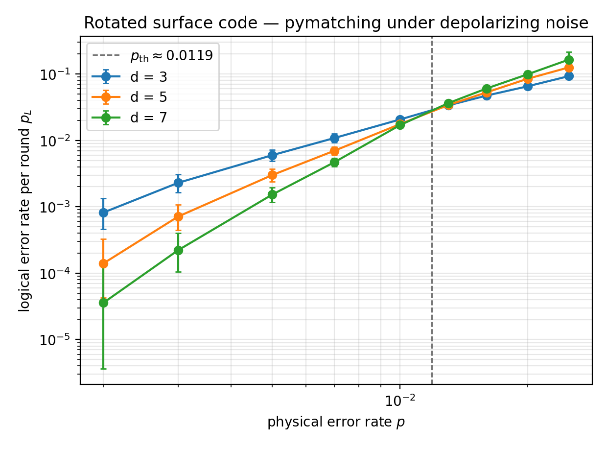
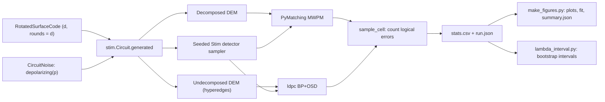

# QEC-Project

A quantum error correction (QEC) curriculum built from linear algebra upward, ending in a reproducible decoder benchmark: MWPM against BP+OSD on the rotated surface code, simulated with Stim under circuit-level noise.

[](https://github.com/TirtheshJani/QEC-Project/actions/workflows/ci.yml)
[](LICENSE)
[](pyproject.toml)

A quantum computer needs a decoder that turns syndrome measurements into corrections, accurately and fast enough to keep up with the hardware. I built this repo to learn QEC by implementing it, with a concrete target: an Expression of Interest (EOI) for the *Decoding algorithm optimization* objective of the National Research Council of Canada's [Applied Quantum Computing Challenge](https://nrc.canada.ca/en/research-development/research-collaboration/research-centres/emerging-directions-fault-tolerant-quantum-computing-call-proposals) (QEC stream).

The capstone runs end to end. Seeded Monte Carlo sweeps compare PyMatching (minimum-weight perfect matching, MWPM) and ldpc (belief propagation plus ordered statistics decoding, BP+OSD) on the rotated surface code. Their fitted thresholds, 0.0122 and 0.0134 per round, overlap within fit error. BP+OSD reaches a lower logical error rate at distance 5, and pays for it with roughly 600 times MWPM's sampling-plus-decoding time per shot.

Status (September 2026): curriculum Phases 0, 1 and 3 are done, Phase 2 is partly done, and Phases 4 and 5 plus the written EOI are next.

## Highlights

- A tested Python package, [`src/qec_project`](src/qec_project/), that grows with the curriculum: classical codes (repetition, Hamming(7,4)), Kraus noise channels, the 3-qubit and Shor 9-qubit codes, and for the capstone a `RotatedSurfaceCode` factory over `stim.Circuit.generated`, a `CircuitNoise` model, and a decoder registry for `pymatching`, `bp-osd` and `union-find`.
- Monte Carlo sampling that runs in-process, in [`decoders/harness.py`](src/qec_project/decoders/harness.py). Detection events, bit-packed and drawn from an explicitly seeded Stim sampler, are decoded in 8,192-shot batches, and each cell stops once it reaches a logical-error budget. [`scripts/run_threshold_sweep.py`](scripts/run_threshold_sweep.py) spreads cells over worker processes, rewrites `stats.csv` after every cell so an interrupted sweep resumes, and records argv, commit SHA and library versions in `run.json`.
- Reproducibility you can check. Per-cell seeds use a CRC32 of the decoder name, because Python's `hash()` is salted per process and had made sweeps unrepeatable. To show the older committed data still came from this sampling code, the original salts were recovered by brute force over all 2^16 values, and [`scripts/check_seed_salts.py`](scripts/check_seed_salts.py) regenerates all 27 committed MWPM cells and the 10 BP+OSD cells at p ≤ 0.01 exactly. Figure SVGs are byte-identical across runs.
- Results reported with their uncertainty: a finite-size threshold fit with standard error, sinter likelihood-ratio error bars, and sub-threshold suppression Λ with a seeded parametric bootstrap interval ([`scripts/lambda_interval.py`](scripts/lambda_interval.py)). Comparisons added after the data was seen are labelled post-hoc.
- 182 tests (pytest, with hypothesis property tests in eight test files) plus 2 slow Monte Carlo physics tests behind `-m slow`, per the last verification recorded in `CHANGELOG.md` (2026-09-27). CI runs ruff, mypy (blocking), pytest, and [`scripts/verify_reading_list.py`](scripts/verify_reading_list.py), which fails if any DOI or arXiv ID in [`docs/reading-list.md`](docs/reading-list.md) returns 404 or 410 (403s, rate limits and network errors are soft-passed).
- A research journal, [`CHANGELOG.md`](CHANGELOG.md), with milestones, a seed- and commit-stamped accuracy table, and failed approaches with the reason each one failed. One entry explains why sampling is in-process: `sinter.collect` breaks under NumPy 2.x in the locked environment, so the code samples with Stim directly and reuses only sinter's statistics helpers.

## Results: MWPM vs BP+OSD on the rotated surface code

Each cell is a memory-Z experiment with rounds = d under uniform circuit-level depolarizing noise, with all four `stim.Circuit.generated` noise parameters set to p. The sweep covers nine physical error rates from 0.002 to 0.025 at seed 42, with up to 20,000 shots per cell and an early stop once a cell passes 2,000 logical errors. The numbers come from the committed sweep `capstone/experiments/sweep-2026-06-19-*`, through [`capstone/figures/summary.json`](capstone/figures/summary.json), `scripts/lambda_interval.py`, and the [Phase 3.4 notebook](phase-03-topological-codes/04-threshold-simulation/threshold_simulation.ipynb).

| | MWPM (PyMatching) | BP+OSD (ldpc) |
| --- | --- | --- |
| Distances swept | 3, 5, 7 | 3, 5 |
| Threshold, finite-size fit (per round) | 0.0122 ± 0.0013 | 0.0134 ± 0.0015 |
| Threshold, curve-crossing estimate | 0.0119 | 0.0132 |
| Logical error rate per round, d = 5, p = 0.005 | 3.01 × 10⁻³ | 1.93 × 10⁻³ |
| $\Lambda_{3\to5}$ at p = 0.005 (95% interval) | 1.99 (1.71 to 2.33) | 2.72 (2.27 to 3.25) |
| $\Lambda_{5\to7}$ at p = 0.005 (95% interval) | 1.97 (1.65 to 2.35) | not swept |
| Time per shot, Stim sampling + decoding, d = 3 / d = 5 | 2.1 / 9.1 µs | 123 / 5369 µs |



*MWPM, per-round logical error rate at d = 3, 5, 7. The dashed line is the curve-crossing estimate, not the fitted threshold. Error bars are sinter likelihood-ratio intervals (`max_likelihood_factor=1000`). The MWPM vs BP+OSD plot at d = 5 is [`decoder_comparison_d5_depolarizing.png`](capstone/figures/decoder_comparison_d5_depolarizing.png).*

What the data supports:

- The two fitted thresholds overlap within fit error, so this data does not rank the decoders by threshold.
- BP+OSD's edge is a lower logical error rate at d = 5: 11 to 35% lower per shot for p = 0.003 to 0.01, peaking at p = 0.005. The difference is significant (two-proportion z > 2) only for p = 0.005 to 0.02, and the two decoders saw independently sampled shots, so the comparison is unpaired.
- The edge costs about 60 times MWPM's time per shot at d = 3 and about 600 times at d = 5 (58× and 587× in this sweep; 121× and 719× in the committed rerun, so the d = 3 ratio is good only to about a factor of 2). That trade-off between accuracy and real-time feasibility is what the capstone studies.

What to keep in mind:

- Both decoders start from the same Stim circuit, but MWPM (PyMatching's default, uncorrelated matching) decodes the decomposed (graphlike) detector error model and BP+OSD the undecomposed one with its hyperedges. The comparison does not separate the decoding algorithm from the error model it is given.
- Time per shot is wall-clock time for Stim sampling plus decoding, summed over the p grid at each distance and divided by the total shots there, with cells running in parallel worker processes. BP+OSD is ldpc's `SinterBpOsdDecoder` (min-sum BP, `max_iter=20`, OSD-CS of order 7), driven through its file-based sinter interface once per batch. This timing moves with machine load: the committed rerun measured 1.0 µs (MWPM) and 118 µs (BP+OSD) at d = 3, and 7.0 and 5048 µs at d = 5. For decoding alone, the [Phase 3.3 notebook](phase-03-topological-codes/03-mwpm-pymatching/mwpm_pymatching.ipynb) measures PyMatching at 3.28 µs per shot at d = 5, p = 0.005 on one core.
- The threshold is fitted as $p_L = A\,(p/p_\mathrm{th})^{(d+1)/2}$ to per-round rates over the whole p grid (the per-shot curves cross lower, near p = 0.007). Restricting the fit to p ≤ 0.01, a post-hoc check printed by `make_figures.py --p-max 0.01`, gives 0.0101 ± 0.0005 (MWPM) and 0.0122 ± 0.0013 (BP+OSD).
- A post-hoc comparison, added after the data was seen, puts BP+OSD's $\Lambda_{3\to5}$ at 1.36 times MWPM's at p = 0.005 (95% interval 1.08 to 1.73). At p = 0.003, 0.007 and 0.01 the ratios are 1.12, 1.07 and 1.07, and each interval includes 1.
- `summary.json` also records Λ at the lowest swept p (0.002, named in its `lambda_p_phys` field), where cells hold only 5 to 49 logical errors. The table quotes p = 0.005, where each cell holds 192 to 355.
- The committed 2026-06-19 sweep was sampled with per-process seed salts. A deterministic rerun of the same commands, committed as `capstone/experiments/rerun-2026-09-26-*`, gives thresholds of 0.0123 ± 0.0012 (MWPM) and 0.0145 ± 0.0016 (BP+OSD), consistent within fit error.
- The threshold belongs to this uniform noise model and is not directly comparable to published circuit-level thresholds under other models such as SI1000.

Sweep provenance and the full reproduction steps are in [`capstone/experiments/README.md`](capstone/experiments/README.md). Accuracy rows at p = 0.005, with seed and commit, are in the [`CHANGELOG.md`](CHANGELOG.md) accuracy table.

## How the benchmark works

A `RotatedSurfaceCode` and a `CircuitNoise` profile produce a noisy memory circuit through `stim.Circuit.generated`. At d = 7 that circuit has 336 detectors, and its decomposed detector error model at p = 0.005 has 6,602 error mechanisms (Phase 3.1 notebook output). `harness.sample_cell` compiles the decoder for one (decoder, distance, p) cell, samples detection events and observable flips from a seeded Stim sampler, and counts shots where the predicted observable flip disagrees with the true one. The sweep script writes those counts; the analysis module turns them into per-round rates, fits, and figures.



The analysis code is in [`src/qec_project/analysis/threshold.py`](src/qec_project/analysis/threshold.py): per-shot to per-round conversion and binomial intervals through sinter's helpers, the curve-crossing estimate, the log-linear least-squares threshold fit, Λ ratios, and the plots. When the curves do not cross inside the swept range, `estimate_threshold` returns `nan` instead of a number.

## Curriculum

Each topic has a notebook generated by the `_build_notebook.py` next to it, and reusable code is promoted into `src/qec_project` with tests.

| Phase | Topics | Status |
| --- | --- | --- |
| [0. Foundations](phase-00-foundations/) | Linear algebra and tensor products; probability and the binary symmetric channel; repetition and Hamming(7,4) codes with syndrome decoding | Done |
| [1. Quantum basics](phase-01-quantum-basics/) | Qubits and Clifford gates; Bell states, superdense coding and teleportation in Qiskit + Aer; density matrices and Kraus channels | Done |
| [2. QEC fundamentals](phase-02-qec-fundamentals/) | 3-qubit repetition code (shown to do worse than no code under depolarizing noise, since it triples exposure to Z errors); Shor 9-qubit code, checked to correct all 27 single-qubit Pauli errors | 2.1 and 2.2 done; stabilizer formalism, Steane and intro to Stim not started |
| [3. Topological codes](phase-03-topological-codes/) | Rotated surface code in Stim; syndrome extraction; MWPM with PyMatching; threshold simulation and the decoder benchmark | Done |
| [4. Fault tolerance](phase-04-fault-tolerance/) | FT syndrome extraction, magic state distillation, lattice surgery | Planned |
| [5. Advanced decoders](phase-05-advanced-decoders/) | BP, BP+OSD on qLDPC codes, Union-Find, neural decoders, bivariate bicycle codes | Planned |
| [Capstone](capstone/) | Decoder benchmark study and mock EOI | First slice done (MWPM vs BP+OSD, depolarizing noise); the rest of the matrix is planned |

## Tech stack

| Area | Tools |
| --- | --- |
| Simulation | Stim (circuits, detector error models, sampling) |
| Decoders | PyMatching (MWPM), ldpc (BP+OSD; belief-find wired but not yet swept) |
| Analysis | sinter statistics helpers, NumPy, Matplotlib |
| Curriculum notebooks | Qiskit, Qiskit Aer, JupyterLab |
| Tooling | Python 3.12, uv, pytest, hypothesis, ruff, mypy, pre-commit, GitHub Actions |

## Getting started

Prerequisites: Python 3.12 (pinned in `.python-version`) and [uv](https://docs.astral.sh/uv/).

```bash
git clone https://github.com/TirtheshJani/QEC-Project.git
cd QEC-Project
uv sync --extra dev
```

Run the same checks as CI:

```bash
uv run ruff check .
uv run mypy src/qec_project
uv run pytest                 # slow Monte Carlo tests are deselected by default
uv run pytest -m slow         # the 2 Monte Carlo physics tests (not run in CI)
uv run python scripts/verify_reading_list.py
```

Reproduce the results from the committed sweep data:

```bash
# Figures and summary.json; the rewritten files match the committed ones byte for byte
uv run python scripts/make_figures.py capstone/experiments/sweep-2026-06-19-*/stats.csv --noise depolarizing

# Λ at p = 0.005 with bootstrap intervals, plus the BP+OSD / MWPM ratio (change --p for other rates)
uv run python scripts/lambda_interval.py capstone/experiments/sweep-2026-06-19-*/stats.csv --p 0.005

# Rerun committed cells under the recovered seed salts and compare counts
# (seconds; add --all --workers 2 for the BP+OSD d = 5 cells, about 4 minutes on 2 cores)
uv run python scripts/check_seed_salts.py
```

Run a new sweep. Output goes to `capstone/experiments/sweep-<today>-<decoder>-<noise>/` (or `--run-id`), and rerunning a command into the same directory tops each cell up to `--shots`:

```bash
uv run python scripts/run_threshold_sweep.py \
    --decoder pymatching --noise depolarizing \
    --distances 3 5 7 \
    --p-phys 0.002 0.003 0.005 0.007 0.01 0.013 0.016 0.02 0.025 \
    --shots 20000 --max-errors 2000 --seed 42
```

For BP+OSD use `--decoder bp-osd --distances 3 5`; it is much slower per shot, which is why it stops at d = 5 on a local CPU. Add `--changelog` to append accuracy rows to `CHANGELOG.md`.

Open the notebooks:

```bash
uv run jupyter lab
```

The Phase 2.1 and Phase 3 notebooks are stored executed. The Phase 0, Phase 1 and Phase 2.2 notebooks are stored without outputs, so run them to see results.

## Repository layout

```text
QEC-Project/
├── src/qec_project/
│   ├── codes/              # classical, repetition3, shor9, surface (RotatedSurfaceCode)
│   ├── noise/              # BSC, Kraus channels, circuit-level noise profiles
│   ├── decoders/           # PyMatching wrapper, decoder registry, Monte Carlo harness
│   ├── analysis/           # density-matrix helpers; threshold fits, Λ, plots
│   ├── linalg.py           # Paulis, unitarity check, tensor products
│   └── info.py             # binary entropy, BSC capacity
├── tests/                  # pytest + hypothesis, mirrors src/ and scripts/
├── scripts/                # sweep, figures, Λ intervals, seed-salt check, reading-list check
├── phase-00-foundations/   # one folder per phase: README, notebooks, notebook builders
├── phase-01-quantum-basics/
├── phase-02-qec-fundamentals/
├── phase-03-topological-codes/
├── phase-04-fault-tolerance/      # plan only
├── phase-05-advanced-decoders/    # plan only
├── capstone/
│   ├── experiments/        # committed sweeps and reruns: stats.csv + run.json
│   ├── figures/            # PNG and SVG plots, summary.json
│   └── proposal/           # mock EOI draft, literature-review stub
├── docs/                   # reading list, glossary, NRC call notes
├── plans/                  # task plans for the curriculum notebooks
├── CHANGELOG.md            # research journal and accuracy table
└── pyproject.toml
```

## Status and roadmap

Phases 0, 1 and 3 are done, along with Phase 2.1 (3-qubit repetition code), Phase 2.2 (Shor 9), the first capstone slice described above, and a [mock EOI draft](capstone/proposal/eoi-mock.md) whose methodology section is backed by the Phase 3 results.

Next, from the current status in `CHANGELOG.md`:

- Curriculum: Phase 2.3 to 2.5 (stabilizer formalism, Steane code, intro to Stim), then Phase 4 (fault tolerance), Phase 5 (advanced decoders), and the written EOI.
- Capstone method: a decoder-only latency benchmark; paired decoding, with both decoders on the same sampled syndromes; a control that gives both decoders the same detector error model; a binomially weighted threshold fit on the sub-threshold window; per-invocation `run.json` manifests that flag a dirty working tree.
- Capstone scope, per [`capstone/README.md`](capstone/README.md): Union-Find and a small neural decoder, SI1000 and biased noise, d = 9, and more shots per cell. In the code today, `--noise SI1000` is an approximate profile that has not been swept, `biased` and `leakage` noise raise `NotImplementedError`, and the sweep script's `--remote` (Modal) and `neural` options exit with a roadmap message.
- The [literature review](capstone/proposal/literature-review.md) is a stub, and no paper draft exists yet.

## References and acknowledgements

The benchmark is built on open-source tools from the QEC community. Their papers, plus the surface-code reference the code cites, are listed with identifiers in [`docs/reading-list.md`](docs/reading-list.md):

- C. Gidney, *Stim: a fast stabilizer circuit simulator*, Quantum 5, 497 (2021). doi:10.22331/q-2021-07-06-497.
- O. Higgott, C. Gidney, *Sparse Blossom: correcting a million errors per core second with minimum-weight matching*, arXiv:2303.15933 (PyMatching).
- J. Roffe, D. R. White, S. Burton, E. Campbell, *Decoding across the quantum LDPC code landscape*, Phys. Rev. Research 2, 043423 (2020). doi:10.1103/PhysRevResearch.2.043423 (BP+OSD, the ldpc package).
- A. G. Fowler, M. Mariantoni, J. M. Martinis, A. N. Cleland, *Surface codes: Towards practical large-scale quantum computation*, Phys. Rev. A 86, 032324 (2012). doi:10.1103/PhysRevA.86.032324.

The Phase 1.2 and Phase 2.2 notebooks use Qiskit, and Phase 1.2 also runs on Qiskit Aer. NRC call priorities and EOI criteria are summarized in [`docs/nrc-call-notes.md`](docs/nrc-call-notes.md), and terms are defined in [`docs/glossary.md`](docs/glossary.md).

## Author

Tirthesh Jani ([GitHub](https://github.com/TirtheshJani), [LinkedIn](https://www.linkedin.com/in/tirthesh-jani))

## License

MIT, see [`LICENSE`](LICENSE).
